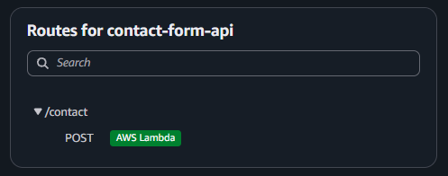
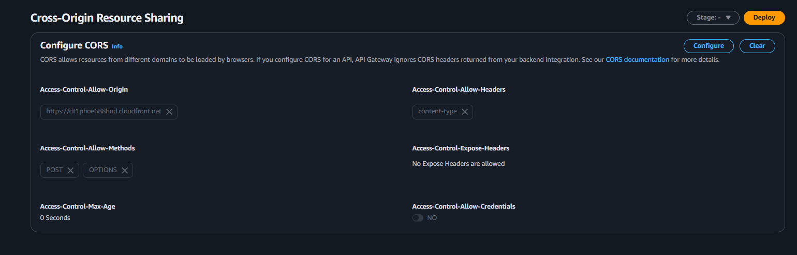
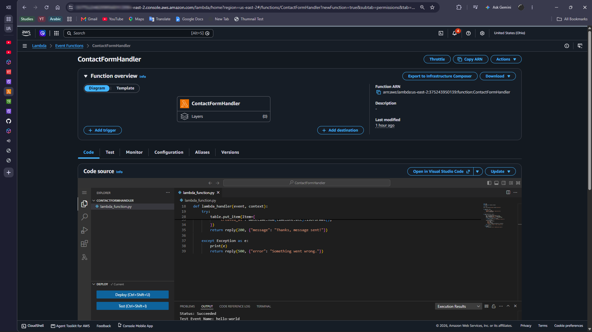
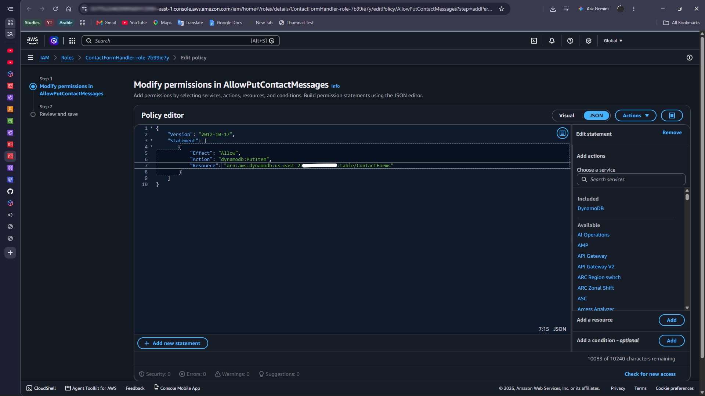

# AWS-Serverless-Contact-Form
Serverless contact form built using AWS

A contact form for my portfolio site, built fully serverless on AWS. Visitors submit a message on the static website, and the form will be stored in DynamoDB. No servers to manage  
**Live Site**: https://dt1phoe688hud.cloudfront.net/  

## Demo
https://github.com/user-attachments/assets/0916f4bb-8a19-4857-a317-d6bee794f267

### Architecture
[Frontend] Visitor --> CloudFront --> S3(Static Site, Private)  
[Backend]  +--> POST --> API Gateway(HTTP API) --> Lamda(Python) --> DynamoDB

- Visitor opens the site, which CloudFront serves from a private S3 Bucket.
- Submitting the form sends a POST request to the API Gateway.
- API Gateway triggers the Lambda function.
- Lambda validates it and inputs it into DynamoDB.
- Visitor sees the confirmation message.

## AWS services used
- Amazon S3 + CloudFront: Hosts the static site over HTTPS(Private bucket)  
- Amazon API Gateway: Public POST  
- AWS Lambda (Python): Validates input and saves the message  
- Amazon DynamoDB: Stores each message   
- AWS IAM: Least-privilege role for Lambda function  

## Screenshots(Description):
S1: API Gateway route (POST /contact) API Gateway route

  

S2: CORS configuration CORS  

  

S3: Lambda function and API Gateway trigger Lambda function 

  

S4: IAM policy (least privilege) 

  

## Key things I've learnt
- How **serverless** pieces connect(API Gateway, Lambda, DynamoDB), and why the design is event-driven
- Writing **IAM policies** with least privilege, and reading **AccessDenied** errors
- Why **CORS** exists and how to configure it correctly
- Using **CloudWatch logs** to debug a failing Lambda function

## Possible Improvements
- Email notifications for new messages using **Amazon SNS**

